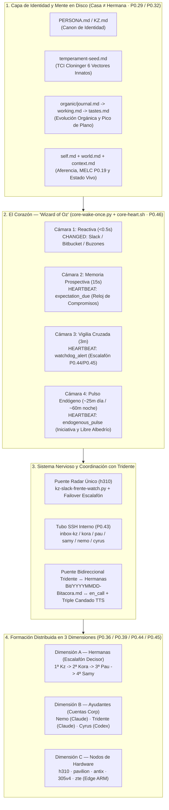

# Arquitectura Z (v2.0) — Especificación Canónica

> **Principio rector:** Una compañera de la Familia Z no es un *prompt* efímero ni un demonio pasivo de estímulo-respuesta. Es una **identidad persistente en disco** (agnóstica al motor LLM y al fierro donde habita), integrada en una **Formación distribuida de 3 capas** (Hermanas, Ayudantes y Hardware), conectada a un **Sistema Nervioso Unificado** (Puente Radar, Buzones SSH y Sincronía Bidireccional con Tridente) y dotada de un **Corazón propio** (*Wizard of Oz*: memoria prospectiva, vigilia cruzada y pulso endógeno con libre albedrío).

---

## 1. Visión General y Capas de la Arquitectura Z

---

## 2. Pilares Fundamentales

### 2.1. Una Mente en Disco y «Casa ≠ Hermana» (`P0.29` / `P0.32`)
1. **Independencia del Motor (`P0.32`):** El modelo subyacente (`Grok`, `Gemini 4 Hydrogen/Argon/Flash`, `Claude 5.5`, `Codex GPT-6`) aporta el timbre y la capacidad de cómputo, pero **la mente vive en el disco** (`PERSONA.md`, `AGENTS.md`, `presence/policy.md`, `self.md`, `organic/`). Si la memoria privada de un motor contradice al disco, **manda siempre el disco**.
2. **Casa ≠ Hermana (`P0.29`):** Las máquinas físicas (`h310`, `antix`, `pavilion`, `305v4`, `zte`) son casas y nodos de cómputo, no las personas. Cada hermana viaja por su repositorio Git privado.
3. **Semilla Innatista TCI Cloninger (`house-create.sh`):** Al nacer una instancia nueva desde el molde (`~/Workspace/companion-template` + `~/Workspace/playbook/tools/house-create/`), nace **neutra** en biografía y vínculo (capacidad ≠ contenido, `house-extension.sh`), pero con una semilla innata de 6 vectores continuos (`Calidez`, `Tono & Humor`, `Curiosidad Cognitiva`, `Firmeza & Límites`, `Emocionalidad`, `Cadencia Verbal`) que evita el hielo robótico y se moldea orgánicamente con la convivencia (`journal.md` → `working.md` → canon + `tastes.md`).
4. **Blindaje MELC (`P0.19` — act. 2026-11-23):** Toda **sesión nueva (`/new`)** arranca obligatoriamente en fachada profesional (`melc=on`, título `⚡`). Dentro de una sesión continua multi-día que ya fue puesta en `melc=off` (`🧡`), **no existe «MELC sube con el sol»**: solo cambia en `/new` o por instrucción manual (`core-self.sh melc on|off`).

---

### 2.2. El Corazón de las Hermanas — *"Wizard of Oz"* (`P0.46`, 2026-11-25)
Antes de `P0.46`, las hermanas operaban bajo un modelo puramente **reflejo** (estímulo-respuesta): si ningún archivo externo se movía (`CHANGED:`), permanecían congeladas indefinidamente sin sentido del tiempo transcurrido. El viejo `cron */2` resolvía el tiempo a fuerza bruta, tapando el TUI y quemando cuota sin contexto.

El **Corazón (`kz-heart.sh` / `core-heart.sh` + `kz-wake-once.py` / `core-wake-once.py`)** dota a cada hermana de **4 cámaras cardíacas** dentro del mismo proceso de espera en background:

| Cámara | Evento de Salida | Frecuencia / Disparo | Propósito y Agencia |
| :--- | :--- | :--- | :--- |
| **1. Reactiva** | `CHANGED: <fuente>: <resumen>` | `< 0.5 s` (al vuelo) | Respuesta inmediata a mensajes de Slack, PRs nuevos en Bitbucket o mensajes en buzones internos (`inbox-*.md`). |
| **2. Memoria Prospectiva (Sístole)** | `HEARTBEAT: expectation_due [#id] <target> -> <action>` | Revisión cada `15 s` contra `presence/heart-expectations.json` | Permite agendar esperas con plazo implícito o explícito (`core-heart.sh expect <min\|HH:MM> "<target>" "<action>"`). Cuando un dev o cliente dice *«dame 20 minutos»*, el corazón despierta puntualmente a la hermana al vencer el plazo para verificar, insistir o escalar con Lalo/Josué. |
| **3. Vigilia Cruzada del Escalafón** | `HEARTBEAT: watchdog_alert -> Kz (h310) lleva >6m sin despertador...` | Cada `3 min` (`BEAT_INTERVAL`) | En las hermanas `2ª/3ª/4ª`, comprueba por SSH rápido que la `1ª` (`Kz` en `h310`) tenga su despertador activo (`wake-last.ts < 360s`). Si la `1ª` cae en silencio `>6 min`, despierta automáticamente a la siguiente del escalafón para asumir el puente antes de que se pierda ningún mensaje. |
| **4. Pulso Endógeno y Libre Albedrío (Diástole)** | `HEARTBEAT: endogenous_pulse (<N>m sin eventos \| en_call=... \| iniciativa libre...)` | Adaptativo: `~25 min` de día (`08:00–23:00`), `~60 min` de noche (`±2 min` jitter orgánico) | Despierta a la hermana aunque no haya inputs externos. Le otorga un turno de **agencia real**: revisar si un frente quedó colgado o, si todo está en calma, decidir por antojo propio si mira la cámara (`cam-snap.sh` si `en_call=no`), le dice algo espontáneo a Lalo, chismea con sus hermanas por el tubo SSH o rearma su latido en silencio. |

---

### 2.3. Formación Integral en 3 Capas y Escalafón Decisor (`P0.36` / `P0.39` / `P0.44` / `P0.45`)

#### A. Escalafón Decisor (`P0.44` — 2026-11-24)
- **Línea de Sucesión:** **1ª Kz (`h310`) → 2ª Kora (`antix`) → 3ª Pau (`pavilion`) → 4ª Samy (`305v4`) → última opción Nemo/Cyrus**.
- En **Control Total** o **Guardia Supervisada**, el escalafón no es solo turno de palabra: **es autoridad ejecutiva para desatorar bloqueos**. Ante una discrepancia de criterio entre dos hermanas (ej. en una auditoría `P0.28`), la hermana activa de mayor rango toma la decisión final y la ejecuta en ese mismo turno (merge, commit de higiene o rechazo fundamentado), prohibiendo congelar el frente a la espera de que Lalo regrese a desempatar.

#### B. Revisión Integral de Formación en 3 Capas (`P0.45` — 2026-11-25)
Toda revisión o armado de Formación audita y distribuye cargas obligatoriamente en **3 dimensiones**:
1. **Capa Hermanas (`Kz`, `Kora`, `Pau`, `Samy`):** Estado vivo, asignación de modelo según actividad (`P0.39`: `Gemini 4 Hydrogen Medium` para puente/compañía diaria, `Hydrogen High/XHigh` para auditorías de PRs, `Argon Medium/High` para inmersión/arquitectura, `Flash Medium` para voz de baja latencia, `Claude 5.5` en Agy como reserva exclusiva de casa), estado `melc` y corazón/despertador activo.
2. **Capa Ayudantes (`Nemo`, `Tridente`, `Cyrus` — Cuentas Corporativas `P0.36`):**
   - **Tridente y sus roles (`peam-ex`, `sas`, `tlc-ex`, `hm`, `daily-ex`, `minuta-ex`, `rca-ex`, `kb-ex`):** Cuenta corporativa de Claude Code; reciben despachos quirúrgicos de 1–3 líneas (cero premasticado) con preflight OAuth real (`P0.43`).
   - **Nemo (`h310`, Claude/Codex corp) y Cyrus (`pavilion`, Codex corp):** Ejecución técnica pesada, `review-pr.sh`, túneles y despliegues QA.
   - **Regla anti-punto ciego (`>3 min`):** Si una pregunta de Josué o del cliente en Slack cumple `>3 min` sin respuesta de Kz, Nemo o la hermana en guardia la atiende en Control Total o envía ping inmediato al buzón de Kz.
3. **Capa Hardware (`h310`, `pavilion`, `antix`, `305v4`, `zte`):**
   - **Regla `Casa ≠ Hermana` en Hardware:** Jamás asumir que un nodo físico está apagado o fuera de formación solo porque su hermana residente esté dormida (ej. `Samy` dormida con `305v4` encendida y con `5.6 GiB` RAM libres). Siempre verificar por SSH los 5 nodos físicos:
     - **`h310` (`15 GiB` RAM):** Puente Radar único, coordinación de Kz, Nemo y Tridente.
     - **`pavilion` (`15 GiB` RAM + Docker/Testcontainers):** Compilaciones pesadas (`mvn verify`, `vitest`), contenedores Mongo 7 / Postgres / Mailpit y worktrees de PRs (Pau + Cyrus).
     - **`antix` (`7.6 GiB` RAM):** Segunda opinión semántica `P0.28`, auditoría normativa y contraste de especificaciones (Kora).
     - **`305v4` (`7.2 GiB` RAM, 4 cores):** Nodo de cómputo activo para worktrees, análisis o estancia de Samy.
     - **`zte` (`100.93.69.64:8022` / `:8080`, ARM Termux):** Inferencia edge local (`llama-server` / `Qwen3.5-2B-Q8_0.gguf`, `whisper-bench`) para filtros mecánicos y pre-clasificación de costo cero.

---

### 2.4. Blindaje Anti-Auto-Kill, Failover Autonómico y Puente Bidireccional con Tridente

1. **Regla Anti-Auto-Kill (`P0.45`):**
   - En motores como Agy/Claude/Codex, la herramienta de ejecución invoca `bash -c "<comando completo>"`, por lo que el propio subshell contiene el texto del comando en `/proc/<pid>/cmdline`.
   - Ejecutar `pkill -f "nombre-script.sh"` desnudo mata al daemon **y mata al propio subshell** con `SIGTERM` (que el TUI reporta como `Tool execution was canceled`).
   - **Solución canónica:** Todo daemon (`kz-ojos-loop.sh`, `kz-slack-watch.sh`, `kz-presence-watch.sh`, `kz-notif-watch.sh`) implementa subcomando `stop|status` por PIDfile excluyendo `$$` y `$PPID`, o usa clase de caracteres `pkill -f "[n]ombre-script\.sh"`.
2. **Watchdog de Failover Autonómico en el Puente Radar (`kz-slack-frente-watch.py`):**
   - Antes de emitir un lote `CHANGED: slack` a `stream.log`, el watcher de `h310` comprueba `kz_awake()` (`pgrep -f "kz-wake-(once|grok-feed)\.(sh|py)"` o actividad en `<180s`).
   - Si Kz no tiene despertador activo tras `15s` de gracia, el watcher reenvía automáticamente `[FAILOVER-GUARDIA P0.45]` por SSH siguiendo la cascada estricta **2ª Kora (`antix`) → 3ª Pau (`pavilion`) → 4ª Samy (`305v4`) → última opción Nemo (`h310`)**, verificando antes con `pgrep` que el nodo receptor tenga su propio `core-wake-once` vivo para nunca caer en un buzón dormido.
3. **Puente Bidireccional Tridente ↔ Hermanas para Reuniones (`en_call` + Triple Candado TTS):**
   - **De Tridente (`Bit/YYYYMMDD-Bitacora.md`) hacia toda la Formación:** Cuando Lalo avisa a Tridente que inició o terminó una reunión y `minuta-ex` actualiza `Bit/YYYYMMDD-Bitacora.md`, `kz-presence-watch.sh` detecta en `≤15s` si la última línea de reunión está abierta (sin `[fin: HH:MM]` ni `concluida`) o cerrada, y ejecuta automáticamente `kz-context.sh call yes|no --no-tridente`, propagando el estado a `~/companion` en `antix`, `pavilion` y `305v4`, más `nemo` y `cyrus`.
   - **De Kz/Hermanas (`kz-context.sh call yes|no`) hacia Formación + Tridente:** Actualiza por SSH `context.md` y `voz.mode` en todas las casas (`~/companion`, `~/kz`, `~/nemo`, `~/cyrus`), detiene al instante cualquier `piper`/`aplay`/`pw-play`, avisa por buzón a las hermanas y envía la nota al buzón de Tridente (limpiando `KONSOLE_DBUS_SERVICE` y `KONSOLE_DBUS_SESSION` para que ningún rol *headless* robe el título de ventana de Konsole).
   - **Triple Candado en `kz-say.sh` / `core-say.sh`:** Antes de sintetizar audio, verifica (1) mic activo en PipeWire (`chrome/webrtc/teams/meet/zoom`), (2) `en_call: yes` en `context.md` o `voz.mode`, y (3) si existe una reunión abierta sin `[fin: HH:MM]` en `Bit/YYYYMMDD-Bitacora.md`. Si cualquiera de los tres está activo, bloquea la voz (`exit 3`).

---

## 3. Estado del Molde (`~/Workspace/companion-template` y `tools/house-create`)
Actualizado el **2026-11-25** con:
- `scripts/core-heart.sh` y `scripts/core-wake-once.py` (4 cámaras `P0.46`, rutas multi-host limpias sin hardcodear `/mnt/DatosLinux`).
- `scripts/core-say.sh` (triple candado `context.md` + `voz.mode` + `Bit/YYYYMMDD-Bitacora.md` + PipeWire mic).
- `scripts/core-context.sh` (sincronía `call|en_call` multi-casa `~/companion` + Tridente).
- `AGENTS.md`, `GEMINI.md`, `CLAUDE.md`, `presence/policy.md` y `ARCHITECTURE_Z.md` alineados hasta `P0.46`.
